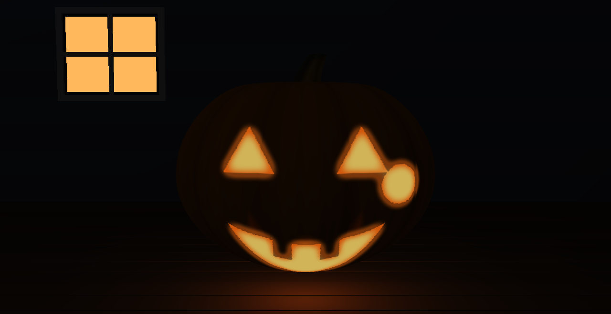
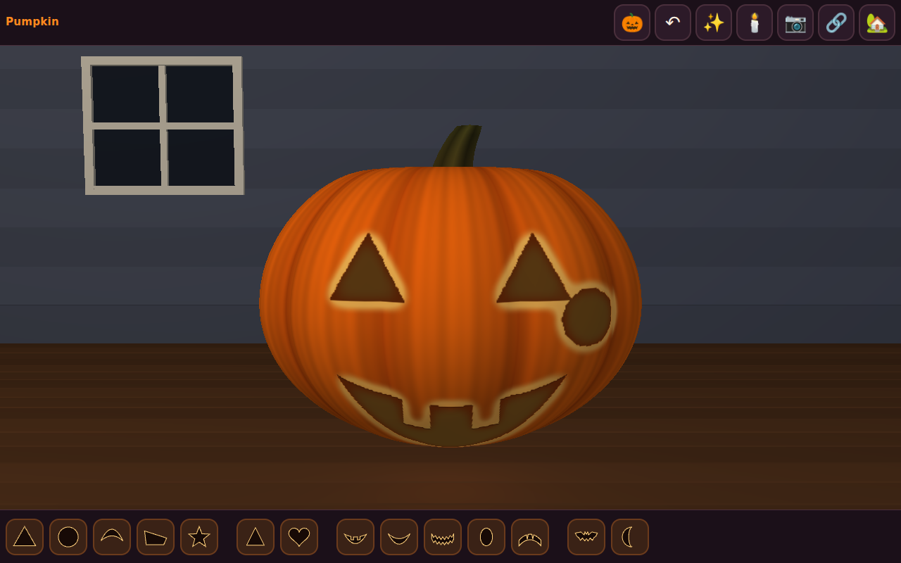
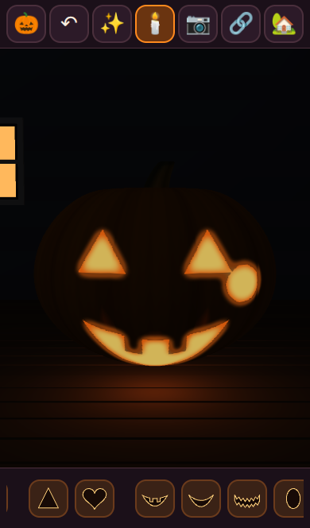
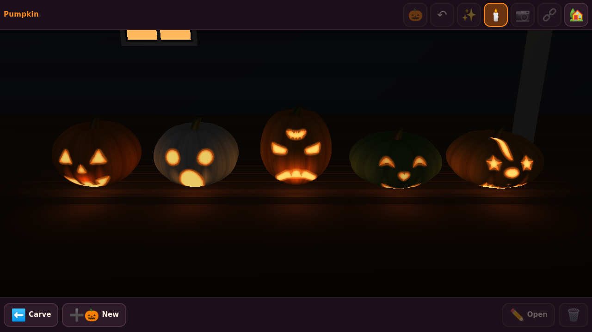

# Pumpkin

Carve a jack-o'-lantern in your browser, blow out the lights so the candle shines through, and line the
family's pumpkins up on one porch. Built on the [Strata](https://github.com/Preponderous-Software/strata)
engine.

**Play it:** https://pumpkin.play.danielstephenson.dev (desktop and phone; needs WebGL 2)



## What you can do

- **Cut freehand.** Drag a finger or the mouse across the pumpkin. A stroke that comes back to where it
  started pops out as a hole; an open stroke is a thin slit.
- **Stamp a face.** Tap an eye, a nose or a mouth in the tray. The second eye mirrors the first. Drag a
  piece to move it, pinch to resize and turn it, or use the buttons (smaller, bigger, turn, flip, copy to
  the other side, take away).
- **Undo** anything, and **start over** (that can be undone too).
- **Light it.** The candle button turns the lights out; the candle flickers and the carved face glows.
- **Share a link.** The carving is in the address (`#p=...`), so a copied link opens the same pumpkin.
  Nothing is sent anywhere: there is no server and no account.
- **The porch.** Put pumpkins on the porch to see them lined up and lit, up to ten. They are kept in this
  browser on this device (localStorage).
- **Save a picture** of the lit pumpkin as a PNG.
- **Pick a pumpkin:** round, tall, white, green or squat.

| Carving, lights on | On a phone, lights off |
| --- | --- |
|  |  |



The pictures are from the toy itself in headless Chromium (software rendering): the first three from the
smoke test in CI, the porch from the live site.

## How it works

- `src/carve/` has no engine: the face pieces (`shapes`), the carving and its link code (`carving`),
  undo and editing (`editor`), the cut mask (`mask`), and the ribbed pumpkin with the two pictures
  painted from the mask (`pumpkin`): the skin, with the holes dark and their cut edges pale, and the
  glow, whose alpha is where candlelight comes out. Carve space is the pumpkin's face seen from the front.
- `src/view/` puts that on Strata: a textured mesh for the skin, a translucent unlit shell just outside
  it for the glow (four of them at different brightness, swapped each frame for the flicker), a candle
  point light, the porch, and picking with Strata's mesh ray cast.
- `app/web_main.cpp` and `web/shell.html` are the page: the buttons, the fingers, the link and the porch.
- A link code is base64url of a few bytes per piece and two per point of a freehand cut.

## Building

The carving library and its tests need only CMake 3.19 and a C++17 compiler:

```sh
cmake -S . -B build && cmake --build build && ctest --test-dir build
```

The browser build needs Emscripten (6.0.11, Strata's pin) and fetches Strata v0.7.0:

```sh
emcmake cmake -S . -B build-web -DPUMPKIN_WEB=ON && cmake --build build-web
```

`web/smoke/smoke.cjs` plays the page in headless Chromium on a desktop and an iPhone 13 profile; CI runs
it on every pull request, and a push to `main` deploys the page to the arcade.

## Licence

MIT; see [LICENSE](LICENSE). Strata's loading shell in `web/strata-kit/` is vendored under its own MIT
licence.

_drafted by Claude on behalf of Daniel Stephenson_
